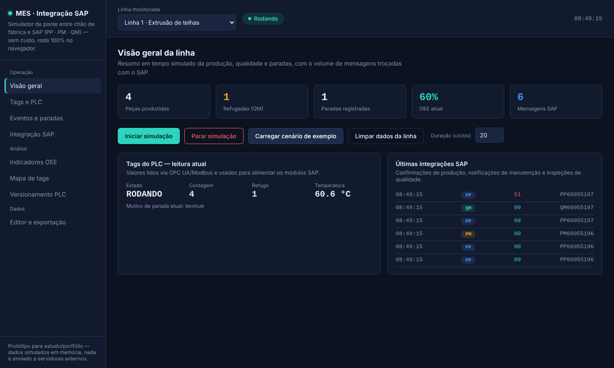
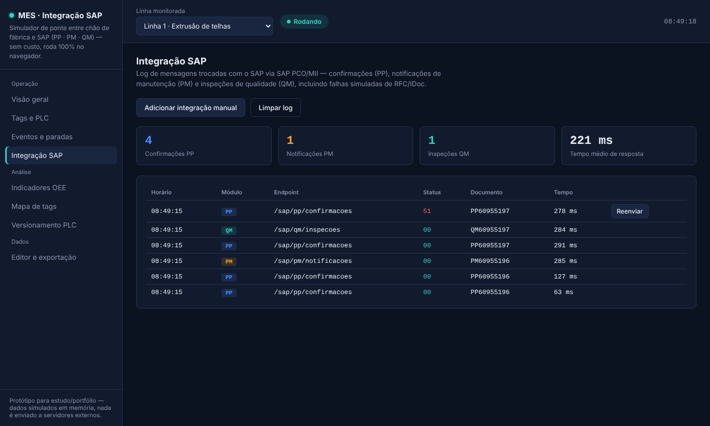

  

<h1 align="center">Painel MES · Integração Chão de Fábrica com SAP</h1>

Simulador de ponte entre o chão de fábrica e o SAP (módulos <b>PP</b>, <b>PM</b> e <b>QM</b>). Roda 100% no navegador, com dados simulados e sem conexão com um SAP real.

  

     

---

## 📌 Sobre

Projeto de estudo que mostra como eventos de produção coletados de PLCs podem alimentar processos do SAP: confirmações de produção (PP), notificações de manutenção (PM) e inspeções de qualidade (QM). Inclui falhas simuladas de RFC/IDoc e reenvio de mensagens, como acontece numa integração real.

## 🖼️ Demonstração

  
   Visão geral da linha com cenário de exemplo carregado

  
   Log de integração com o SAP

## ✨ Funcionalidades

- Leitura simulada de tags de PLC (protocolos **OPC UA** e **Modbus**) com qualidade do sinal
- Registro de eventos de produção, refugos e paradas, com inclusão manual
- Log de mensagens trocadas com o SAP, incluindo falhas simuladas de RFC/IDoc e reenvio
- Cálculo de **OEE** (disponibilidade, performance e qualidade) com histórico
- Mapa de tags, versionamento de programas de PLC e editor com exportação (CSV/TXT)

## 🛠️ Tecnologias

`HTML5` · `CSS3` · `JavaScript` · `Chart.js`

## ▶️ Como usar

Abra a demo, ou baixe o repositório e abra o `index.html` no navegador. Depois clique em **Iniciar simulação** ou **Carregar cenário de exemplo**.

Não precisa instalar nada nem rodar servidor: é só HTML, CSS e JavaScript.

## 📝 Observações

Projeto de estudo/portfólio. Todos os dados são simulados e ficam em memória no navegador; nada é enviado a servidores.

---

## 👤 Autor

**Daniel da Silva Rezende** — estudante de Engenharia de Software e Análise e Desenvolvimento de Sistemas.

